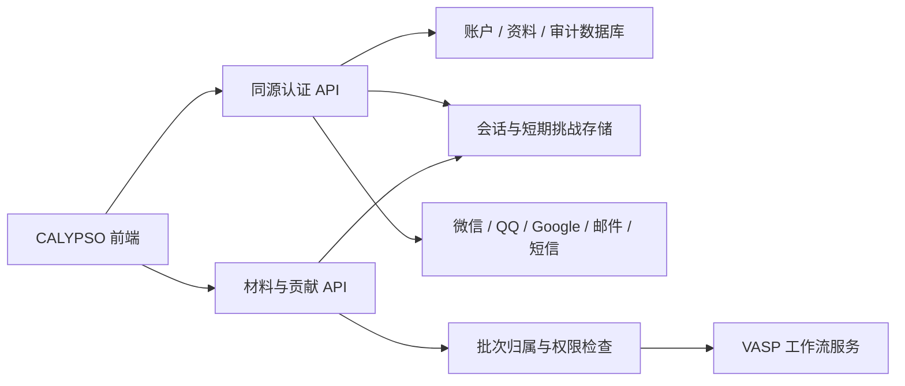

# 账户与认证接入指南（v8.1）

本轮实现的是本地账户测试流程与可接入真实服务的前端适配器。没有建立正式认证服务、发送验证码、生成有效扫码二维码，也没有公开上传数据或运行 VASP。

## 现在怎么测试

本项目的 `.env.local` 已启用 `NEXT_PUBLIC_ENABLE_LOCAL_ACCOUNTS=true`。运行 `npm run dev`，访问 `/login`。

| 测试身份     | 标识                    | 操作                              |
| ------------ | ----------------------- | --------------------------------- |
| 普通研究用户 | researcher@calypso.test | 点击 Test researcher，无需密码    |
| 管理员       | admin@calypso.test      | 点击 Test administrator，无需密码 |

这些是明确标注的测试身份，不是真实邮箱账号。本地开关只在 `NODE_ENV=development`、明确启用、且浏览器主机为 localhost / 127.0.0.1 / [::1] 时可用。默认生产构建关闭测试账户；公网演示可以单独启用下面的演示开关。配置真实认证 API 后优先使用真实服务，不会降级为测试身份。

### 发布公网演示版

Cloudflare 的 Build command 设置为：

```sh
NEXT_PUBLIC_ENABLE_DEMO_ACCOUNTS=true npm run build
```

Deploy command 保持 `npx wrangler deploy`。也可以在 Cloudflare 的构建环境变量中设置 `NEXT_PUBLIC_ENABLE_DEMO_ACCOUNTS=true`，构建命令保持 `npm run build`。这是构建时开关，修改后必须重新构建部署，单独修改 Worker 运行时变量不会更新浏览器代码。

演示时保持 `NEXT_PUBLIC_AUTH_API_BASE` 为空。发布包含此代码改动的 Git 提交后，重新构建部署，访问 `/login`，可以选择 Test researcher 或 Test administrator。原来的 `NEXT_PUBLIC_ENABLE_LOCAL_ACCOUNTS=true` 不会开启公网演示。

账户、测试注册、资料与角色只保存在每个访问者自己的浏览器中；本机测试账户不会上传，不同设备不共享账户或草稿。页面标注 DEMO ONLY，不提供正式认证。关闭演示时去掉演示开关或设为 `false`，再重新构建部署。

- 首页、About、文档保持公开。Explore、贡献编辑、我的贡献、个人资料和管理页面要求登录。
- 访问检索深链接时，登录后保留查询、筛选和锚点。返回地址只接受已知站内产品路由。
- 个人资料可保存姓名、联系邮箱、机构、部门、课题组、身份阶段、ORCID 格式和国家/地区。机构与 ORCID 均未认证；联系邮箱与登录标识分开。
- 贡献页面点击 Apply my profile 才复制署名快照。资料变更不追溯修改旧批次。批次公开与计算授权仍分别选择。
- 本地 sessionStorage 保存当前标签页的测试身份，8 小时到期；localStorage 保存测试资料与角色。IndexedDB 按 `mode:userId` 分隔批次。它们是界面隔离，不是安全隔离，同一设备仍可通过开发者工具读取。
- 旧版 IndexedDB 的未归属草稿保留原件，通过“Copy to this account”明确复制，生成新批次 ID 并重置授权。不同正式用户之间不能靠这个机制转移服务器数据。
- 管理员可以对另一个测试账户授予/撤销管理员角色，填写理由并保存本地变更记录；不能修改自身权限或移除最后一个管理员。该记录不是防篡改的服务器审计。
- 不存储明文密码、OAuth token、微信/QQ密钥或短信密钥。测试资料请使用虚构信息；浏览器清理会删除本地内容。

## 注册流程

`/login` 与 `/signup` 独立，相互切换时保留 returnTo 查询与锚点。导航栏与移动菜单也有 Sign up 入口。注册时一次填写：账号用户名、邮箱、密码及确认密码、姓名、机构、课题组、身份阶段；不能跳过科研资料。注册完成直接返回原页面，不再有可跳过的后置资料向导。部门、ORCID、地区等补充字段留在个人资料页面。

本地测试注册创建 member、emailVerified=false、publicProfile=false 的独立身份。账号用户名和邮箱去首尾空格并转小写，均检查同设备唯一性；用户名支持 3–32 个字母、数字、点、下划线、短横线，以字母开头；密码为 10–128 字符，保留空格。本地密码使用 Web Crypto 的 PBKDF2-HMAC-SHA-256、独立随机盐与 600,000 次迭代，只保存校验记录，不保存明文或确认密码。仍不是正式认证边界，请只使用虚构资料与测试密码。

退出后在 Sign in 的 Account 方式中填写账号或邮箱以及密码。两个预置测试身份保留开发快捷按钮，不代表正式免密登录；新注册用户不能使用该快捷逻辑。旧的无密码本地身份和草稿保留、不自动改写密码，其正式迁移/恢复需后端处理。本地上限 10 个身份，包含预置身份；浏览器清理会删除这些本地资料。贡献联系邮箱与登录邮箱分开，不自动复制。

真实邮箱/短信注册先验证 sign-up challenge，再在同一事务中建立用户名、密码凭据、研究资料与 member 会话。已有身份使用 Sign in；缺少必填资料、重复用户名或身份不能覆盖旧用户。第三方注册先通过 POST 保存受匿名会话保护的完整注册草稿，服务器立即哈希密码并设置短期有效期；返回仅含不透明 ticket 的同源 OAuth 启动路径，经平台认证后才建立正式账户与资料。密码、科研资料和邮箱不能进入 OAuth URL、state 明文或日志；不接受未验证的同邮箱自动合并。

正式密码在 HTTPS 下发送给认证服务并由服务端哈希，不能直接拿本地测试哈希作为正式凭据。后端建议使用成熟库实现 Argon2id 并按部署环境验证成本；勿保存明文或可逆加密密码。依据 [OWASP Password Storage 指南](https://cheatsheetseries.owasp.org/cheatsheets/Password_Storage_Cheat_Sheet.html)（2026-10-12核对）。本轮未接入密码恢复、改密或正式验证码。正式上线的条款/隐私政策需要真实批准文本，当前不展示虚构协议。

## 后端怎么搭建

建议让网站域名提供一个同源认证入口，例如 `/api/identity`，由反向代理转到独立的认证服务。材料检索、上传、审核与工作流服务都使用相同的稳定 `userId`。材料 API 也建议反向代理为同源路径（例如 `/api/materials`）；当前前端不会向跨域材料 API 携带认证 Cookie。代理只从已验证的服务端会话推导上游身份，不相信浏览器自报身份头。语言可沿用团队现有后端；无需为了登录更换前端框架。关系数据库持久化用户、资料、身份绑定和审计；会话及短期验证码可放在支持过期和原子操作的服务端存储中。验证码发送、OAuth 交换与 VASP 调度分离。



推荐按以下顺序落地：

1. **账户、密码和邮箱验证码**：先完成唯一用户名、服务端密码哈希、必填科研资料、稳定用户 ID、匿名挑战、验证码验证、正式 Cookie 会话、资料编辑、退出和材料 API 登录校验。区分 sign-in 与 sign-up 挑战：登录只登录已有账户，注册原子消费专用挑战并创建普通用户；不能相信前端传入的邮箱已认证。
2. **管理员**：部署时通过只在服务端执行的一次性命令指定首位管理员。不提供“第一个访问者成为管理员”接口。增加角色授权、理由、版本冲突检查、审计和敏感操作重新认证。
3. **其他登录渠道**：分别申请应用与回调域名、配置提供方密钥、接入短信/邮件发送服务。只有渠道真实可用，`GET /providers` 才返回 enabled=true。
4. **贡献服务**：提交时从会话确定 ownerId，文件归属、私有下载、批次查询、事件推送及计算授权均在服务端校验。不要使用作者署名或前端 userId 代替归属验证。
5. **工作流服务**：审核通过与计算授权满足后创建真实任务。批次事件包含服务器给出的阶段、步骤、日志权限和进度依据，前端展示这些事件；不得用动画模拟真实计算百分比。

### 基础数据表

| 表                   | 关键字段与约束                                                                                                                                                                     |
| -------------------- | ---------------------------------------------------------------------------------------------------------------------------------------------------------------------------------- |
| users                | id、status、created_at；角色由服务端授予，默认 member                                                                                                                              |
| profiles             | user_id、display_name、contact_email、institution、department、research_group、career_stage、orcid、country_region、public_profile=false、version；公开字段白名单，不公开邮箱/电话 |
| identities           | user_id、provider、provider_subject、verified_email；provider+subject 唯一，不自动合并未验证邮箱相同的账户                                                                         |
| password_credentials | user_id、password_hash、algorithm、version、changed_at；服务端哈希与校验，不在账户响应返回                                                                                         |
| sessions             | session_id_hash、user_id、created_at、expires_at、revoked_at；仅服务端保存会话与 token，浏览器拿 HttpOnly Cookie                                                                   |
| login_challenges     | id、channel、destination、purpose、code_hash、expires_at、retry_at、attempts、used_at；一次性验证、原子消费、限流，不保存/记录明文验证码                                           |
| role_audit           | actor_id、target_id、old_role、new_role、reason、created_at、request_id；受限写入、保留记录；不包含验证码/token                                                                    |
| contribution_batches | owner_id 外键、requested_visibility、attribution_snapshot、permission_version、review/status；原始贡献与标准计算记录保持分离                                                       |

### 会话与权限要求

正式服务使用 HTTPS、随机不透明会话 ID，以及 `Secure; HttpOnly; SameSite=Lax` 的 Cookie（跨站流程需按提供方协议验证）。写请求验证 Origin/CSRF；登录、权限变更和重新认证后更新/撤销有关会话。会话设置服务端闲置与绝对过期；退出撤销服务端会话。参见 [OWASP 会话管理](https://cheatsheetseries.owasp.org/cheatsheets/Session_Management_Cheat_Sheet.html)。

前端 AuthGate 只是交互入口；真正的检索限制必须在材料 API 每次请求实施。所有账户、批次、下载和事件接口都检查当前身份及对象权限，默认拒绝。管理员角色不能自动读取所有私有科研文件；可另设经授权的审核范围。参见 [OWASP 授权指南](https://cheatsheetseries.owasp.org/cheatsheets/Authorization_Cheat_Sheet.html)。

管理员角色变更须在一个数据库事务中检查权限、expectedVersion、禁止自改与最后管理员保护，更新角色、写审计并使目标会话重新读取权限。建议管理员使用更强的重新认证/MFA。资料 PATCH 只接受明确的 profile 字段，忽略/拒绝 role、ownerId、verified 标记，防止批量赋值越权。

## 前端已经预留的 HTTP 合约

设置 `NEXT_PUBLIC_AUTH_API_BASE=/api/identity`。它必须是同源路径。接口响应、字段类型见 `lib/accounts/model.ts`，具体请求见 `lib/accounts/client.ts`。均使用 `credentials=same-origin` 与 `cache=no-store`。以下路径相对于该 base。

| 方法 / 路径                             | 输入 / 输出                                                                                                                                                                                            |
| --------------------------------------- | ------------------------------------------------------------------------------------------------------------------------------------------------------------------------------------------------------ |
| GET /providers                          | 返回 id 为 password、wechat、qq、sms、email、google 的 `{id,enabled}` 数组；服务真实可用才启用，不返回密钥                                                                                             |
| GET /session                            | `{user,csrfToken,expiresAt}`；user 可空，匿名也有 CSRF 上下文；禁止公共缓存                                                                                                                            |
| POST /password/sign-in                  | `{identity,password}` → user 非空的 session 响应；identity 为账号或邮箱；服务端校验密码并限流，不泄露用户名是否存在                                                                                    |
| POST /challenges                        | `{channel,destination,purpose?:"sign-up"}` → `{id,expiresAt,retryAt}`；省略 purpose 是 sign-in；六位数字验证码                                                                                         |
| POST /challenges/verify                 | `{challengeId,code}` → session；仅消费 sign-in 挑战并登录已有账户；设置正式 Cookie                                                                                                                     |
| POST /registrations                     | `{challengeId,code,username,password,profile}` → user 非空的 session；原子消费 sign-up 挑战、校验必填资料、创建 member 与私有资料；不接收自报 role 或 emailVerified                                    |
| POST /registrations/oauth               | `{provider,registration:{username,email,password,profile},returnTo}` → `{redirectPath}`；服务端保存短期注册草稿并哈希密码；路径形如 `/api/identity/oauth/google/start?ticket=opaque`，不得含密码和资料 |
| GET /oauth/:provider/start?returnTo=... | 登录时顶层导航；服务端保存受保护 state、用途与允许的返回地址；注册启动路径消费专用 ticket                                                                                                              |
| GET /oauth/:provider/callback           | 验证 state、身份和授权码；注册只消费完整的注册草稿并建立普通用户；登录不能绕过注册必填资料；失败返回对应页面                                                                                           |
| PATCH /me/profile                       | `{profile,expectedVersion}` → AccountUser；联系邮箱不会改变登录标识；只允许资料字段                                                                                                                    |
| POST /logout                            | `{}` → `{ok:true}`；撤销服务端会话并清除 Cookie                                                                                                                                                        |
| GET /admin/users                        | `{items,audit}`；仅管理员，不返回密码哈希或凭据；大量账户需要接分页/搜索                                                                                                                               |
| PATCH /admin/users/:id/role             | `{role,reason,expectedVersion}` → AccountUser；角色与审计在同一事务中更新                                                                                                                              |

非 GET 请求带 `X-CSRF-Token`。不使用 localStorage 中的测试 token 作为真实凭据。约定 400 无效输入/验证码、401 登录失效或错误密码、403 无权、409 版本冲突或经验证后的注册冲突、429 限流；错误体不泄露身份、验证码或平台密钥。前端显示服务器声明的 retryAt 倒计时和挑战过期状态。注册挑战必须绑定匿名会话、用途、渠道与归一化目标；`POST /registrations` 从挑战读取真实目标，不接收客户端自报 email、role 或 emailVerified。注册失败不得消耗已有登录身份或覆盖已有资料。OAuth intent 在服务端 state 中保存并校验，不能仅相信回调查询参数。

AccountUser 为 `{id,email:string|null,emailVerified,loginLabel?:string,username?:string,role,profile,version}`。username 对已有身份可缺省，新注册账号必填且唯一；密码/密码哈希绝不属于该响应。未提供邮箱的手机号/平台身份允许 email=null、emailVerified=false；loginLabel 可提供经过隐私处理的账号显示标识。Profile 为上述资料字段；careerStage 值为 `"" | undergraduate | masters | doctoral | postdoc | faculty | researcher | industry | other`。联系方式与 ORCID 的客户端检查只是格式检查，不是认证。RoleAudit 为 `{id,actorId,targetId,previousRole,role,reason,at}`。

已有手机号或平台身份的响应仍兼容 email=null；新注册表单要求提供邮箱，但不能因填写就视为认证。短信或平台认证只验证该渠道，其他邮箱是否验证由后端独立记录。贡献联系邮箱由用户自愿填写；填写并不代表已认证。账户绑定/解绑、MFA、恢复与全设备会话管理需在正式服务阶段按业务需要实现；不要生成伪邮箱冒充已验证邮箱。

### 每个登录渠道要准备什么

- **Google**：Google Cloud OAuth Web 客户端、授权回调地址；服务端验证 state 与 ID token 的 issuer/audience/expiry，遵循提供方要求。可采用 authorization-code + OIDC 流程；账户绑定须验证已有会话，不能只按邮箱字符串合并。[Google OIDC 文档](https://developers.google.com/identity/openid-connect/openid-connect)、[Web Server OAuth 指南](https://developers.google.com/identity/protocols/oauth2/web-server)。
- **QQ**：QQ 互联的网站应用及回调配置，服务端授权码换 token，再获取经过平台验证的 OpenID；申请与回调要求以官方最新文档为准。[QQ Server-side 指南](https://wiki.connect.qq.com/开发攻略_server-side)。
- **微信**：微信开放平台的网站应用与相应资格、正式回调域名及服务端密钥；上线时核对官方最新网站应用登录文档，分别处理扫码授权、取消与过期。本轮官方页面读取受限，未把平台参数或审核条件写死。[微信开放平台](https://open.weixin.qq.com/)。
- **短信**：供应商账号、签名与模板、发送地区、限流与费用控制；国际区号归一化，短期验证码原子消费。不要求访客先用短信注册一个单独账户。
- **邮箱**：发信域名/地址和可用邮件服务，配置发信认证与退信处理；限制挑战次数、验证码猜测与重发频率。无需在前端放 SMTP/API 凭据。

所有渠道关联同一个内部 userId。增加或移除关联身份时需要已有会话和重新认证，保留至少一个可用登录方式。不要将测试身份的 ID、资料、权限或贡献归属自动导入正式数据库。

## 正式接入前验收

生产构建无测试登录入口；绕过前端访问检索 API 返回 401；普通用户访问 admin API 返回 403；猜测他人批次/下载/SSE ID 无法读取；私有记录不进公开检索/统计；匿名 challenge 的 CSRF、验证码过期/一次性/限流有效；OAuth state 与返回路由受校验；退出和降权使旧会话无效；profile PATCH 不能改 role；并发更新返回 409；日志不含验证码、Cookie 或原始 provider token。
